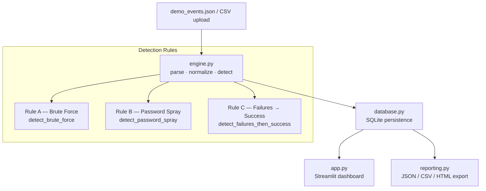

# NazarSOC

A local-first, explainable **Mini Security Operations Center** built as a cybersecurity fresher portfolio project.  
Detects authentication attack patterns in synthetic log data, stores findings in SQLite, and presents them in a Streamlit dashboard — no cloud services, no Docker, no paid APIs required.

> **Synthetic data only.** All events, IPs, and usernames are fabricated for educational purposes.  
> This tool is not production-ready and makes no guarantee of real-world detection accuracy.

---

## Architecture



---

## File Overview

| File | Purpose |
|---|---|
| `engine.py` | Parse, normalize and detect — no Streamlit or DB dependency |
| `database.py` | SQLite schema, import batches, events, incidents, evidence |
| `reporting.py` | Metrics evaluation, JSON/CSV/HTML export |
| `app.py` | Streamlit dashboard — 5 pages |
| `demo_events.json` | Synthetic RFC 5737 authentication events |
| `test_project.py` | 246 unit tests (unittest) |
| `requirements.txt` | Runtime dependencies |
| `run.bat` | Windows launcher — creates venv, installs deps, starts dashboard |
| `.gitignore` | Excludes venv, database files, cache |

---

## Quick Start (Windows)

```bat
git clone <repo-url>
cd NazarSOC
run.bat
```

`run.bat` will:
1. Create a Python virtual environment in `.\venv` (skips if already present).
2. Install dependencies from `requirements.txt`.
3. Launch the dashboard at **http://127.0.0.1:8501**.

**Manual steps** (cross-platform):

```bash
python -m venv venv
# Windows:
venv\Scripts\activate
# Linux / macOS:
source venv/bin/activate

pip install -r requirements.txt
python -m streamlit run app.py --server.address 127.0.0.1 --server.port 8501
```

---

## Running the Tests

```bash
python -m unittest test_project -v
python -O -m unittest test_project -v   # also verify assert-free paths
```

Expected: **246 tests, 0 failures, 0 errors** in both modes.

---

## Detection Rules

All thresholds and time windows are configurable via keyword arguments on each detection function.

### Rule A — Brute Force (`detect_brute_force`)

| Parameter | Default |
|---|---|
| Minimum failures | 5 |
| Time window | 5 minutes |
| Group by | `source_ip` + `username` |

- MITRE ATT&CK: **T1110.001** — Brute Force: Password Guessing  
- Severity: **High** | Confidence: **Medium**  
- Fires when ≥ 5 `auth_failure` events share the same IP and username within a 5-minute sliding window.

### Rule B — Password Spraying (`detect_password_spray`)

| Parameter | Default |
|---|---|
| Minimum failures | 10 |
| Minimum distinct usernames | 5 |
| Time window | 10 minutes |
| Group by | `source_ip` |

- MITRE ATT&CK: **T1110.003** — Brute Force: Password Spraying  
- Severity: **High** | Confidence: **Medium**  
- Fires when ≥ 10 failures span ≥ 5 distinct usernames from the same IP within 10 minutes.  
- Detection is labelled *possible* spraying; does not confirm malicious intent.

### Rule C — Failures Followed by Success (`detect_failures_then_success`)

| Parameter | Default |
|---|---|
| Minimum prior failures | 3 |
| Time window | 10 minutes |
| Group by | `source_ip` + `username` |

- MITRE ATT&CK: **T1110.001** — Brute Force: Password Guessing  
- Severity: **Critical** | Confidence: **Medium**  
- Fires when ≥ 3 failures are followed by a success for the same IP and username within 10 minutes.  
- Warrants investigation; does not claim the account was compromised.

---

## Duplicate Prevention

Each detection gets a deterministic SHA-256 identifier derived from:
`rule_id + source_ip + sorted(usernames) + window_start (minute-truncated)`

Overlapping sliding windows that produce the same logical alert collapse to one detection.  
The `save_detections` function in `database.py` enforces uniqueness via `INSERT OR IGNORE`.

---

## Dashboard Pages

| Page | Description |
|---|---|
| Overview | KPI tiles — total events, incidents, open/closed counts |
| Events | Import demo data or upload JSON/CSV; paginated event table |
| Incidents | Incident list with status/disposition workflow; detail drill-down |
| Quality Lab | Run `evaluate_scenarios` on the built-in labelled dataset; display metrics |
| Reports | Download incidents as JSON, CSV, or HTML; download metrics CSV |

---

## Event Schema

Required fields for detection: `event_id`, `timestamp`, `source_ip`, `username`, `event_type`, `outcome`.

| Field | Type | Notes |
|---|---|---|
| `event_id` | string | Unique per source; max 256 chars |
| `timestamp` | string | ISO 8601 UTC; e.g. `2024-01-15T10:00:00Z` |
| `source_type` | string | e.g. `windows_security`, `linux_auth` |
| `source_ip` | string | Valid IPv4 or IPv6; RFC 5737 ranges in demo data |
| `username` | string | Normalised to lowercase; max 256 chars |
| `event_type` | string | `authentication` (only supported type) |
| `outcome` | string | `success` or `failure` |
| `hostname` | string | Optional |
| `source_reference` | string | Optional log file or channel |
| `import_batch` | string | Optional batch identifier |

---

## Known Limitations

- **Synthetic evaluation only.** Precision/Recall/F1 figures are computed on a built-in labelled dataset of fabricated scenarios, not real-world data.
- **Authentication events only.** No support for network flow, process creation, or other log types.
- **No real-time streaming.** Events must be imported explicitly; there is no live tail.
- **Single-user, local SQLite.** Not suitable for concurrent multi-analyst use without schema migration.
- **Windows `run.bat` only.** Linux/macOS users must follow the manual quick-start steps.
- **No TLS.** The dashboard binds to `127.0.0.1` only; do not expose externally.

---

## License

Educational use only. Not licensed for production security monitoring.
